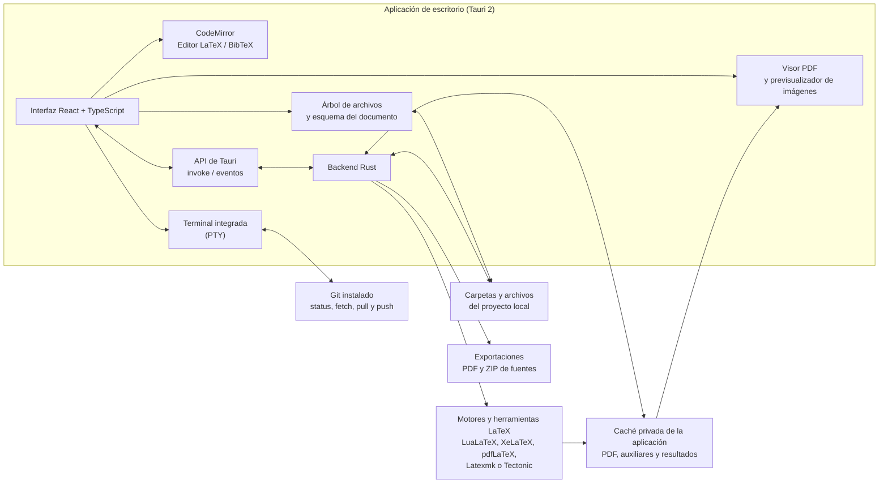

# Latex Workbench

Latex Workbench es una aplicación de escritorio local para editar, compilar y exportar proyectos LaTeX. Ofrece un flujo de trabajo de tres paneles inspirado en Overleaf, pero trabaja directamente con carpetas locales y repositorios Git: tus fuentes y recursos permanecen en tu equipo.

Al iniciar, puedes abrir un proyecto existente o crear un artículo, una tesis, una presentación Beamer o una carta desde una plantilla. La app solo crea la estructura nueva dentro de una carpeta vacía que selecciones.

## Arquitectura



La interfaz React se comunica con el backend Rust mediante comandos y eventos de Tauri. El backend lee y modifica archivos del proyecto, ejecuta las herramientas LaTeX disponibles y mantiene los artefactos de compilación en la caché de la aplicación, fuera de la carpeta del proyecto. La terminal integrada permite usar Git y otras herramientas desde la raíz del proyecto.

## Instalación para desarrollo

### Requisitos

- Node.js LTS y pnpm 11. El proyecto declara pnpm `11.25.0` en `package.json`; puedes habilitar pnpm con Corepack (`corepack enable`).
- Rust estable instalado con [rustup](https://rustup.rs/).
- Dependencias de desarrollo nativas de [Tauri 2](https://v2.tauri.app/start/prerequisites/). En macOS se requieren Xcode Command Line Tools; en Windows, Microsoft C++ Build Tools y WebView2; en Linux, las bibliotecas WebKitGTK y AppIndicator correspondientes a tu distribución.
- Al menos un motor LaTeX compatible instalado y accesible desde `PATH`. LuaLaTeX es el motor seleccionado inicialmente; también se admiten XeLaTeX, pdfLaTeX, Latexmk y Tectonic cuando están instalados.
- Para compilar, el sistema de aislamiento también debe estar disponible: `bubblewrap` en Linux o `sandbox-exec` en macOS. La compilación permanece bloqueada en Windows hasta que se implemente un sandbox compatible.

Instala una distribución TeX que incluya los paquetes requeridos por tus documentos. Por ejemplo, puedes usar MacTeX en macOS, MiKTeX en Windows o TeX Live en Linux. Consulta la guía oficial de [requisitos de Tauri](https://v2.tauri.app/start/prerequisites/) para los detalles y paquetes de tu sistema operativo.
En la aplicación, el selector de compilador indica si cada motor está instalado y ofrece acceso a sus páginas oficiales de descarga. La primera vez que intentes compilar se explica que la distribución TeX se instala por separado. En Debian o Ubuntu, instala el aislamiento con `sudo apt-get install bubblewrap`. macOS incluye `sandbox-exec`; Windows todavía no admite compilación aislada. Como el sandbox bloquea la red, Tectonic puede necesitar que sus paquetes ya estén disponibles localmente.

### Obtener el código y ejecutar

```bash
git clone https://github.com/general-purpose-projects/latex-workbench.git
cd latex-workbench
pnpm install
pnpm tauri dev
```

Para crear los instaladores de producción para la plataforma actual:

```bash
pnpm tauri build
```

Al publicar una etiqueta `v*`, GitHub Actions valida el proyecto en los tres sistemas operativos, genera los paquetes de instalación y adjunta checksums SHA-256 a un release en borrador. Revisa y publica el borrador manualmente; el flujo actual no firma los instaladores.

El frontend se puede comprobar por separado con:

```bash
pnpm check
pnpm build
pnpm test
```

## Funciones principales

- Detecta documentos raíz buscando `\\documentclass` y permite trabajar con proyectos de cualquier estructura.
- Edita fuentes LaTeX y bibliografía BibTeX con CodeMirror.
- Compila con LuaLaTeX, XeLaTeX, pdfLaTeX, Latexmk o Tectonic, si están disponibles y el aislamiento está activo.
- Ofrece perfiles Vista previa (incremental) y Release (reconstrucción completa con Latexmk).
- Permite guardar explícitamente el documento principal, el motor y el perfil en `.latex-workbench.json`.
- Muestra diagnósticos de motores, aislamiento y Git antes de abrir un proyecto.
- Aísla la compilación: bloquea la red, monta las fuentes como solo lectura y limita la escritura a la caché temporal.
- Incluye un visor PDF, navegación por secciones, árbol de archivos y previsualización de imágenes.
- Integra una terminal PTY y acciones de Git para consultar el estado, hacer fetch, pull y push.
- Exporta el PDF y las fuentes del proyecto en archivos ZIP.
- Mantiene `shell-escape` desactivado de forma predeterminada. Actívalo solo para documentos de confianza, ya que permite ejecutar programas externos.

Los resultados y archivos auxiliares se guardan en la caché privada de Latex Workbench fuera del proyecto. Cuando no hay cambios relevantes, el PDF se recupera sin iniciar TeX; cuando los hay, Latexmk reutiliza los auxiliares y ejecuta las etapas necesarias para completar la compilación. Consulta [Seguridad](SECURITY.md) para conocer los límites del aislamiento y los comandos locales que no cubre.

## Licencia

MIT. Consulta [LICENSE](LICENSE).
